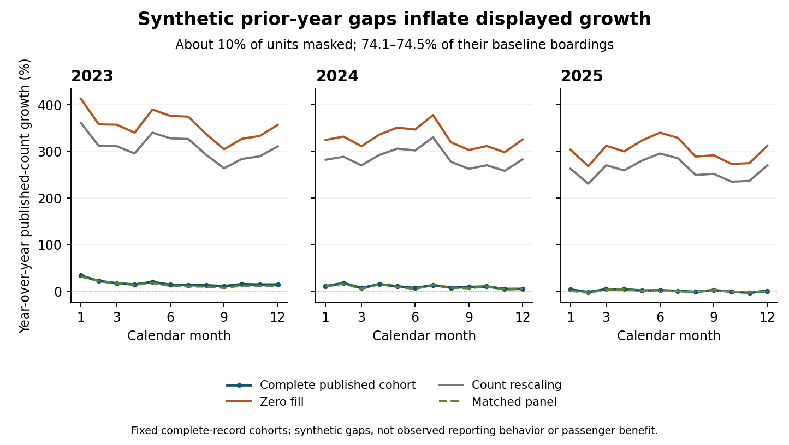

# Transit reporting gaps and apparent growth

When can a year-over-year bus-ridership increase be created by missing reports? This finite comparison tests dashboard summaries against captured published monthly unlinked passenger trips (UPT). Its reporting gaps are synthetic; they are not evidence of actual false agency reports or verified passenger changes.

Fixed stress. Mask prior-year reports from about 10% of service units chosen by largest 2019 boarding volume. These units account for 74.1–74.5% of baseline boardings, making this a concentrated-volume stress. Across 36 held months in 2023–2025, zero-fill mean absolute growth error is 319.349 percentage points, count rescaling 276.125 and matched-panel growth 1.289. Zero fill invents positive growth in four months. The matched panel misses one positive-growth month and changes the observed population.

Decision implication. Display reporting coverage, population and volume shares beside growth. Preserve zero, null and absent rows separately. Obtain service-status and reporting-vintage evidence before certifying an increase. Under illustrative twice-2019 component caps, all 972 aggregate intervals contain the benchmark, but 470 cases violate a cap. Containment alone does not validate assumptions.

## Complete primary comparison

MAE is percentage points. Years have 12 months; pooled has 36. The benchmark is complete captured published records, not passenger truth.

| Year | View | MAE (pp) | Sign errors | False growth | Missed growth |
| --- | --- | --- | --- | --- | --- |
| 2023 | Zero fill | 338.996 | 0 | 0 | 0 |
| 2023 | Count rescaled | 292.988 | 0 | 0 | 0 |
| 2023 | Matched panel | 2.132 | 0 | 0 | 0 |
| 2024 | Zero fill | 318.408 | 0 | 0 | 0 |
| 2024 | Count rescaled | 275.594 | 0 | 0 | 0 |
| 2024 | Matched panel | 0.938 | 0 | 0 | 0 |
| 2025 | Zero fill | 300.642 | 4 | 4 | 0 |
| 2025 | Count rescaled | 259.792 | 4 | 4 | 0 |
| 2025 | Matched panel | 0.795 | 1 | 0 | 1 |
| Pooled | Zero fill | 319.349 | 4 | 4 | 0 |
| Pooled | Count rescaled | 276.125 | 4 | 4 | 0 |
| Pooled | Matched panel | 1.289 | 1 | 0 | 1 |

## Every gap setting

All errors use 36 months. Unit fractions differ from volume shares. No outcome-based selection.

| Units (%) | Rank rule | Missing year(s) | Zero fill | Rescaled | Matched |
| --- | --- | --- | --- | --- | --- |
| 5 | Largest baseline | Prior | 180.929 | 166.068 | 1.477 |
| 5 | Largest baseline | Current | 68.526 | 66.335 | 1.477 |
| 5 | Largest baseline | Both | 1.477 | 1.477 | 1.477 |
| 5 | Smallest baseline | Prior | 0.030 | 5.561 | 0.004 |
| 5 | Smallest baseline | Current | 0.031 | 5.859 | 0.004 |
| 5 | Smallest baseline | Both | 0.004 | 0.004 | 0.004 |
| 5 | Identifier | Prior | 5.304 | 0.557 | 0.191 |
| 5 | Identifier | Current | 5.238 | 0.382 | 0.191 |
| 5 | Identifier | Both | 0.191 | 0.191 | 0.191 |
| 10 | Largest baseline | Prior | 319.349 | 276.125 | 1.289 |
| 10 | Largest baseline | Current | 81.547 | 78.455 | 1.289 |
| 10 | Largest baseline | Both | 1.289 | 1.289 | 1.289 |
| 10 | Smallest baseline | Prior | 0.120 | 10.898 | 0.007 |
| 10 | Smallest baseline | Current | 0.123 | 12.105 | 0.007 |
| 10 | Smallest baseline | Both | 0.007 | 0.007 | 0.007 |
| 10 | Identifier | Prior | 10.514 | 1.553 | 0.251 |
| 10 | Identifier | Current | 9.660 | 1.497 | 0.251 |
| 10 | Identifier | Both | 0.251 | 0.251 | 0.251 |
| 20 | Largest baseline | Prior | 665.585 | 509.878 | 1.511 |
| 20 | Largest baseline | Current | 93.766 | 89.907 | 1.511 |
| 20 | Largest baseline | Both | 1.511 | 1.511 | 1.511 |
| 20 | Smallest baseline | Prior | 0.515 | 21.518 | 0.012 |
| 20 | Smallest baseline | Current | 0.515 | 26.801 | 0.012 |
| 20 | Smallest baseline | Both | 0.012 | 0.012 | 0.012 |
| 20 | Identifier | Prior | 66.045 | 30.842 | 1.202 |
| 20 | Identifier | Current | 41.731 | 24.783 | 1.202 |
| 20 | Identifier | Both | 1.202 | 1.202 | 1.202 |

## All cap groups

Each has 324 cases. Inside means truth contained; Valid means every hidden value under cap. Violations repeat across scenarios.

| Multiplier | Missing year(s) | Cases | Inside | Valid | Violating components |
| --- | --- | --- | --- | --- | --- |
| 1 | Prior | 324 | 314 | 31 | 2347 |
| 1 | Current | 324 | 309 | 0 | 3214 |
| 1 | Both | 324 | 324 | 0 | 5561 |
| 2 | Prior | 324 | 324 | 192 | 204 |
| 2 | Current | 324 | 324 | 157 | 312 |
| 2 | Both | 324 | 324 | 153 | 516 |
| 4 | Prior | 324 | 324 | 214 | 134 |
| 4 | Current | 324 | 324 | 168 | 189 |
| 4 | Both | 324 | 324 | 164 | 323 |

## Evidence and limits

The 38,584-row projection passes 192,920 independent parse and 10,083 server-control checks. It contains 50 explicit nulls and 185 reported zeros. The 2019 roster has 455 agency-service units; held complete pairs have 416, 410 and 403. Absence is not asserted late. Historical vintages and estimation provenance remain unverified.

Eighteen dependencies were frozen before held summaries. Sixteen fixtures, 344,274 exact result fields and 2,160 independent summary fields pass. Replay matches 346,434 CSV fields and three verification documents. All 27 gaps, three point views and three cap assumptions remain available. Matched panels change population and do not guarantee unbiased growth. No empirical missingness, future coverage, causal benefit, operational readiness, savings or novelty claim. Read PROTOCOL.md, FREEZE.json, source hashes, exclusions, results and the independent manuscript. Formal-publication projects including Azure optimization remain private.
